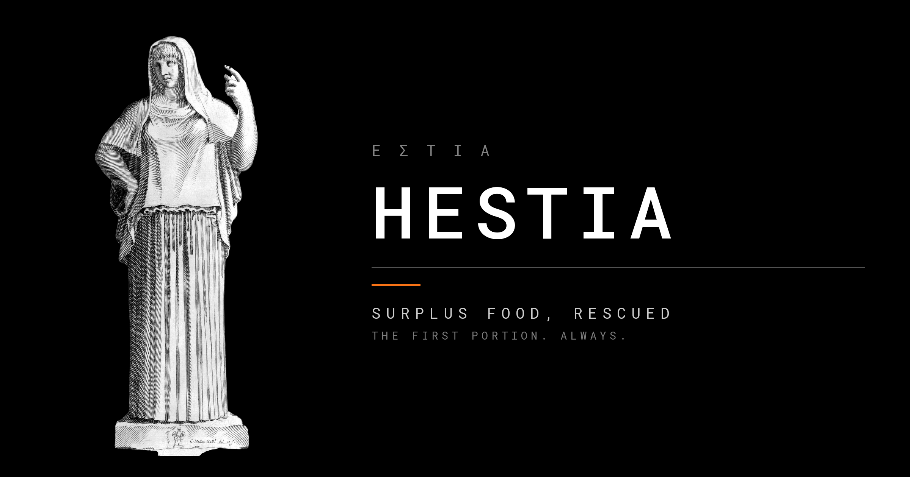
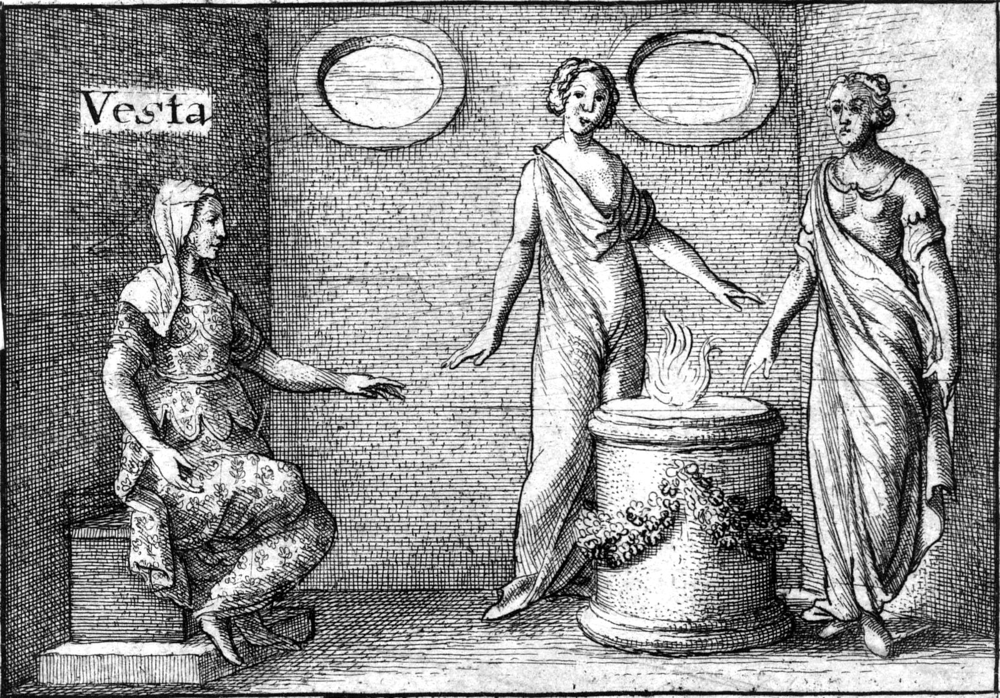

# Hestia

A mobile-first platform that gets surplus cooked and packaged food from
cafeterias, canteens, hostels, restaurants and event venues to verified NGOs
before it goes bad.

> **Status: design phase. There is no code yet.**
> The repository holds the requirements and the data model. See
> [Current state](#current-state) below. This line will change when it stops
> being true, and not before.

---

## Why build this

India throws away a large amount of safe, cooked food every day, while the NGOs
and shelters a few kilometres away could use it. The gap isn't goodwill. It's
**time and trust**: cooked food at room temperature is safe for a few hours, and
neither side can confirm the other is who they claim to be in that window.

So the hard parts of this project are not the screens. They are:

- **Concurrency.** Three NGOs claim the last 20 servings at the same moment.
  Exactly the right claims must succeed, and the rest must fail cleanly.
- **Custody.** Food passes from donor to carrier to NGO. Every handoff has to be
  provable after the fact, by people who don't trust each other.
- **Trust without paperwork theatre.** Anyone can donate, but limits depend on
  track record, and only verified NGOs can receive.

## The name

Hestia is the Greek goddess of the hearth. In every household and every city
she kept the fire that cooked the meal, and **she received the first portion of
every meal.** The image is the thesis:

- the **hearth** is the kitchen with food to spare;
- the **first portion** is the one that goes to someone who needs it, before the
  rest is thrown away.

  
   
  <i>Vesta, Hestia's Roman counterpart, beside the hearth fire. Wenceslaus Hollar, 17th century.</i>

## How it works

1. A college canteen posts 60 servings of veg biryani: safe until 17:00,
   pickup 14:30 to 16:00.
2. Verified NGOs within 3 km are notified. NGO A claims 40, NGO B claims 20.
3. A carrier accepts NGO A's task. Only now can they see the exact address.
4. At the canteen, the carrier's app shows a **pickup code**. Canteen staff enter it.
5. At the NGO, the NGO's app shows a **drop code**. The carrier enters it.
6. NGO A inspects the food and accepts it. The canteen sees
   *"40 servings delivered to NGO A at 15:42."*

Every step is written to a **hash-chained custody log**, so changing or deleting
any past event can be detected.

## Design commitments

Each of these is argued in [`docs/requirements.md`](docs/requirements.md) or
[`docs/data-model.md`](docs/data-model.md).

| Decision | Rejected | Why |
|---|---|---|
| OTP handoffs + hash-chained log | blockchain | a chain can't prove the physical food wasn't tampered with; it adds cost and leaks privacy |
| Database enforces the invariants | checks in app code only | "never over-claimed" and "one carrier per task" must hold under concurrent requests, so they're conditional `UPDATE`s and constraints |
| One hash chain per donation | one global chain | a global chain makes every write on the platform queue for the same "latest hash" |
| Exact location hidden until a carrier accepts | show it to everyone | a home address in a public feed is a safety problem, not a UX detail |
| Trust tiers from real outcomes | star ratings | ratings are gamed; acceptance and no-show rates are not |
| ₹0/month, one VM, free tiers | managed cloud services | a constraint worth designing against, and written down rather than hidden |

The receiver always shows the code and the giver always enters it. It is one
rule for every handoff, so there is nothing to get wrong at a canteen counter.

## Current state

- **Design phase.** Requirements v0.1 and data model v0.1 are written.
- No backend, no app, no tests.
- `docs/data-model.md` is the most useful thing here right now.

## Planned stack

| Part | Choice |
|---|---|
| Mobile app | React Native + Expo, Android only |
| Admin panel | separate web app |
| Backend | Python |
| Database | Postgres + PostGIS |
| Hosting | one small cloud VM, ₹0/month on free tiers |

## Documentation

| File | What it holds |
|---|---|
| [`docs/requirements.md`](docs/requirements.md) | actors, trust tiers, functional and non-functional requirements, tunables, open questions |
| [`docs/data-model.md`](docs/data-model.md) | entities, relationships, how the schema enforces the consistency rules, ER diagram |
| [`docs/img/CREDITS.md`](docs/img/CREDITS.md) | sources and licences for the engravings |

## Context

A portfolio project set in India (DPDP Act 2023, FSSAI surplus-food rules). It's
a demo, not a live service: **all data, organisations and documents are
fictional.**

## License

[MIT](LICENSE)

---

Masthead: *Standbeeld van Hestia* (the Hestia Giustiniani), Rijksmuseum
`RP-P-2015-3-16`, CC0. Full attribution in
[`docs/img/CREDITS.md`](docs/img/CREDITS.md).
