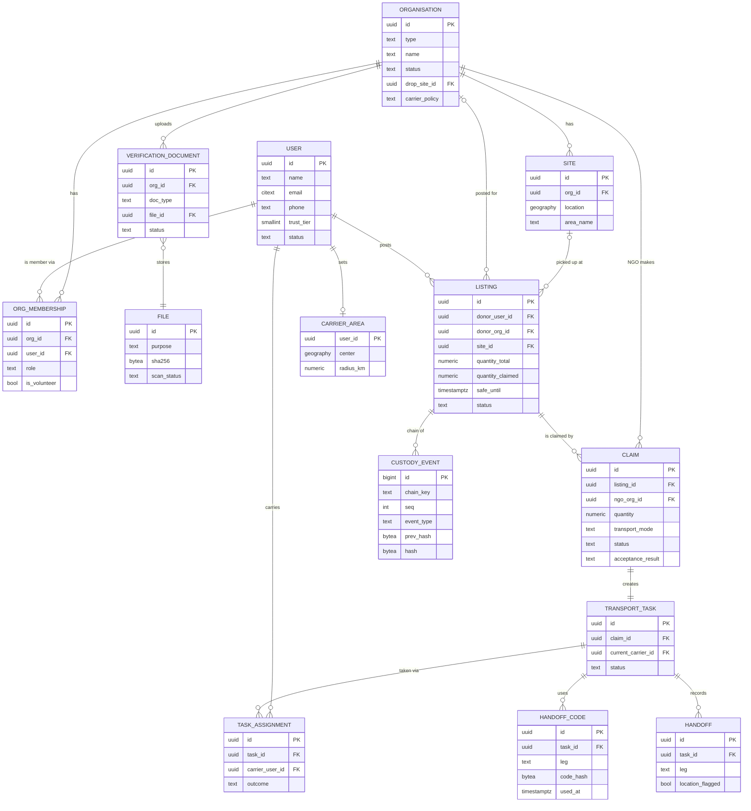

# Data Model

> **Status:** v0.1 draft, 2026-10-09. Derived from `requirements.md` v0.1. Requirement IDs in the **Why** lines point back there. Allowed status changes are in `state-machines.md`.

## Conventions

These apply to every table, so they aren't repeated in each one.

- **Database:** Postgres + PostGIS.
- **IDs:** `uuid` primary keys, generated as UUIDv7. They sort by time, which keeps indexes compact, and they can't be guessed or counted the way serial integers can (NFR-SEC-1).
- **Timestamps:** every table has `created_at` and `updated_at` (`timestamptz`, UTC). All other times are `timestamptz` too.
- **Statuses and enums:** `text` with a `CHECK` constraint, not Postgres `ENUM`. Adding a value is then a simple migration (NFR-MNT-2). Allowed *transitions* are enforced in the service layer and covered by tests (NFR-CON-5).
- **Locations:** `geography(Point, 4326)`. Distance and radius queries use `ST_DWithin` on a GiST index.
- **Secrets:** OTPs and tokens are stored only as hashes (`bytea`), never in plain text (NFR-SEC-2/3).
- **Soft rules vs hard rules:** wherever the database can enforce an invariant on its own (unique index, `CHECK`, row lock), it does. Rules that need app logic are marked *(app)*.

---

## Entities

### 1. Identity and access

### User
Everyone who uses the mobile app. Admins are kept in a separate table (see **AdminAccount**).

| Field | Type | Notes |
|---|---|---|
| id | uuid | primary key. Also the pseudonymous ID used in the custody log |
| name | text | nullable after account deletion |
| email | citext | unique; nullable after deletion. Login is by email OTP (FR-ACC-1) |
| phone | text | E.164 format; unique; nullable until added |
| phone_verified_at | timestamptz | null = not verified. Needed to donate or carry (FR-ACC-2) |
| photo_file_id | uuid | FK → File; optional (FR-ACC-4) |
| trust_tier | smallint | 0 or 1. Tier 2 is never stored, see Why |
| status | text | `ACTIVE`, `SUSPENDED`, `DELETED` |
| suspended_reason | text | nullable |
| carrier_declaration_at | timestamptz | null until the first task is accepted (FR-TRN-7) |
| deleted_at | timestamptz | set when the account is deleted (FR-ACC-6) |

**Relationships:** has many OrgMemberships; has many Listings (as donor); has many TaskAssignments (as carrier); has one CarrierArea; has many Consents, Sessions, DeviceTokens, Notifications.

**Status changes over time:** yes. `ACTIVE ⇄ SUSPENDED`, then `→ DELETED` (final). The tier goes up and down automatically (FR-REP-3).

**Why:**
- **No `user_group` / role column.** Roles belong to a membership in an org, not to the user (requirements §2, Actors and roles). One user can be admin of one org and staff of another, and "carrier" is a capability, not a role.
- **No verification document on users.** Only orgs upload documents (NFR-PRIV-1, no Aadhaar).
- **Tier 2 isn't stored** because it depends on *how* the user is acting: as a member of a verified donor org they get Tier 2, personally they get their own tier (requirements §3, Trust tiers).
- **Deletion anonymises the row instead of removing it.** Name, email, phone and photo are set to null. The `id` stays, so custody events still point at something and the hash chain still checks out, but nothing links that ID to a person any more (NFR-PRIV-5).

### AdminAccount
Platform operators. They only use the separate admin web app.

| Field | Type | Notes |
|---|---|---|
| id | uuid | primary key |
| email | citext | unique |
| name | text | - |
| totp_secret_enc | bytea | encrypted TOTP secret (FR-ADM-5) |
| status | text | `ACTIVE`, `DISABLED` |

**Relationships:** has many AdminAuditEntries; reviews VerificationDocuments and Reports.

**Status changes over time:** yes, `ACTIVE ⇄ DISABLED`.

**Why:** a separate table, not a flag on User. Sign-up can never create an admin (FR-ADM-1), admins need TOTP, and an authorization bug in the mobile API can't give an app user admin powers, because the two kinds of account aren't even in the same table.

### OtpChallenge
Login and phone-verification codes. Handoff codes are kept separately (see **HandoffCode**).

| Field | Type | Notes |
|---|---|---|
| id | uuid | primary key |
| purpose | text | `LOGIN`, `PHONE_VERIFY` |
| target | text | the email or phone the code was sent to |
| user_id | uuid | FK → User; null for a first login |
| code_hash | bytea | - |
| attempts | smallint | at most 5 (NFR-SEC-2) |
| expires_at | timestamptz | created + 10 min |
| consumed_at | timestamptz | null until used |
| request_ip | inet | for the per-IP send limit |

**Status changes over time:** effectively: live → consumed or expired. Rows are deleted after a day.

**Why:** the "5 sends per hour" limit (NFR-SEC-2) is a count query on `(target, created_at)` and `(request_ip, created_at)`, so both are indexed.

### Session
A refresh token for one device.

| Field | Type | Notes |
|---|---|---|
| id | uuid | primary key |
| user_id | uuid | FK → User |
| token_hash | bytea | unique |
| family_id | uuid | all tokens rotated from the same login |
| expires_at | timestamptz | issued + 30 days |
| revoked_at | timestamptz | nullable |
| replaced_by_id | uuid | FK → Session; set on rotation |

**Why:** refresh tokens rotate on every use (NFR-SEC-4). If an already-rotated token is used again, it has probably been stolen, so the whole `family_id` is revoked. "Log out everywhere" (FR-ACC-5) revokes every row for the user. Access tokens are short-lived JWTs and aren't stored.

### Consent
A record of every legal acceptance.

| Field | Type | Notes |
|---|---|---|
| id | uuid | primary key |
| user_id | uuid | FK → User |
| kind | text | `TERMS`, `PRIVACY`, `CARRIER_DECLARATION`, `FOOD_SAFETY_DECLARATION` |
| version | text | the version of the text accepted |
| accepted_at | timestamptz | - |

**Why:** FR-ACC-3 needs *which version, and when*. A single table handles every declaration, and adding a new one doesn't need a migration. The per-listing food-safety tick (FR-LST-3) is stored on the Listing itself instead, because it's part of that listing.

### 2. Organisations

### Organisation
A donor org or an NGO.

| Field | Type | Notes |
|---|---|---|
| id | uuid | primary key |
| type | text | `DONOR_ORG`, `NGO`. Can't be changed after creation |
| subtype | text | donor orgs only: `CORPORATE`, `COLLEGE`, `HOSTEL`, `RESTAURANT`, `CATERER`, `EVENT_VENUE` |
| name | text | - |
| status | text | `UNVERIFIED`, `PENDING`, `VERIFIED`, `REJECTED`, `EXPIRED`, `SUSPENDED` |
| status_reason | text | nullable |
| verified_at | timestamptz | nullable |
| **NGO settings** | | all null for donor orgs, enforced by a `CHECK` on `type` |
| drop_site_id | uuid | FK → Site; where food is delivered (FR-ORG-4) |
| service_radius_km | numeric(5,2) | FR-ORG-4 |
| accepted_diets | text[] | subset of `VEG`, `EGG`, `NON_VEG` |
| carrier_policy | text | `ANYONE`, `MIN_DELIVERIES`, `OWN_VOLUNTEERS`; default `ANYONE` (FR-ORG-6) |
| daily_capacity_servings | int | nullable (FR-ORG-8) |

**Relationships:** has many OrgMemberships, Sites and VerificationDocuments. A donor org has many Listings; an NGO has many Claims.

**Status changes over time:** yes. `UNVERIFIED → PENDING → VERIFIED | REJECTED`, then `VERIFIED → EXPIRED | SUSPENDED` (requirements §5.3, Verification).

**Why:**
- **No `admin_id` column.** An org can have several admins and must always have at least one (FR-ORG-2/3). That lives in OrgMembership. A single `admin_id` would only allow one admin and would need to be kept in sync.
- **No address or coordinates on the org.** They belong to a Site, since an org can have several (FR-ORG-5). Even an org with one location gets one Site, so there's only ever one code path.
- **No verification document column.** An org needs several documents, each with its own status (FR-VER-1/5), so they live in VerificationDocument.
- **NGO settings as columns, not a separate table.** There are only five, they're read on every claim, and the `CHECK` keeps them null for donor orgs.

### OrgMembership
Links a user to an org with a role.

| Field | Type | Notes |
|---|---|---|
| id | uuid | primary key |
| org_id | uuid | FK → Organisation |
| user_id | uuid | FK → User; null while the invite is pending |
| invited_email | citext | used until the invite is accepted |
| role | text | `ORG_ADMIN`, `ORG_STAFF` |
| is_volunteer | boolean | NGOs only (FR-ORG-7) |
| status | text | `INVITED`, `ACTIVE`, `REMOVED` |

Unique: `(org_id, user_id)` where status is not `REMOVED`.

**Status changes over time:** yes, `INVITED → ACTIVE → REMOVED`. The role can switch between admin and staff.

**Why:** "at least one `ORG_ADMIN`" (NFR-CON-6) is enforced by locking the org row (`SELECT … FOR UPDATE`) before any demote or remove, then counting the remaining admins in the same transaction *(app)*. Without the lock, two admins demoting each other at the same moment could leave the org with none.

### Site
One physical location of an org: a cafeteria, a kitchen, an NGO's drop point.

| Field | Type | Notes |
|---|---|---|
| id | uuid | primary key |
| org_id | uuid | FK → Organisation |
| label | text | e.g. "North campus canteen" |
| address | text | - |
| location | geography(Point) | exact pin |
| area_name | text | e.g. "Koramangala"; shown instead of the exact address (FR-CLM-2) |
| contact_phone | text | nullable; shown to the carrier only during an active task |
| archived_at | timestamptz | sites are archived, never deleted, because old listings point at them |

**Relationships:** belongs to one Organisation; has many Listings.

### 3. Verification

### DocumentType
The configurable list of required documents (FR-VER-1).

| Field | Type | Notes |
|---|---|---|
| code | text | primary key, e.g. `FSSAI`, `PAN`, `GSTIN`, `NGO_DARPAN`, `REG_CERT`, `AUTH_LETTER` |
| org_type | text | `DONOR_ORG` or `NGO` |
| label | text | - |
| required | boolean | - |
| id_number_regex | text | nullable; format check (FR-VER-2) |
| has_expiry | boolean | - |
| lookup_url | text | public portal link for the reviewer (FR-VER-7) |

**Why:** a table rather than code, so the list can change without redeploying. GSTIN's check digit can't be expressed as a regex, so that one is extra code keyed by `code` *(app)*.

### VerificationDocument
One uploaded document, plus its automated checks and admin review.

| Field | Type | Notes |
|---|---|---|
| id | uuid | primary key |
| org_id | uuid | FK → Organisation |
| doc_type | text | FK → DocumentType.code |
| file_id | uuid | FK → File |
| id_number | text | as typed by the org admin |
| id_number_normalised | text | upper case, no spaces; used for duplicate detection |
| expires_on | date | nullable |
| status | text | `CHECKING`, `AUTO_REJECTED`, `IN_REVIEW`, `APPROVED`, `REJECTED`, `EXPIRED`, `SUPERSEDED` |
| reason_code | text | nullable; why it was rejected |
| reviewer_note | text | nullable |
| duplicate_of_org_id | uuid | nullable; set when another org used the same ID (FR-VER-3) |
| locked_by_admin_id | uuid | FK → AdminAccount; nullable |
| locked_until | timestamptz | nullable (FR-VER-4) |
| reviewed_by_admin_id | uuid | nullable |
| reviewed_at | timestamptz | nullable |
| uploaded_by_user_id | uuid | FK → User |
| supersedes_id | uuid | FK → VerificationDocument; the rejected doc this one replaces (FR-VER-6) |

**Relationships:** belongs to one Organisation and one File.

**Status changes over time:** yes. `CHECKING → AUTO_REJECTED | IN_REVIEW → APPROVED | REJECTED`. `APPROVED → EXPIRED`. Any of them `→ SUPERSEDED` when a new upload replaces it.

**Why:**
- **Review lock with no lock table.** An admin claims the oldest item with `UPDATE … SET locked_by_admin_id = $me, locked_until = now() + 30 min WHERE id = (SELECT id … WHERE status = 'IN_REVIEW' AND (locked_until IS NULL OR locked_until < now()) ORDER BY created_at LIMIT 1 FOR UPDATE SKIP LOCKED)`. Two admins can never get the same item (FR-VER-4).
- **Resubmission makes a new row**, rather than overwriting the old one, so the history of what was rejected and why is kept.
- **Duplicate IDs are flagged, not blocked.** A unique index would stop a legitimate case (e.g. a franchise sharing a GSTIN) and would leak "this ID is taken" to the uploader. The reviewer decides.

### File
Every stored blob: verification documents and photos.

| Field | Type | Notes |
|---|---|---|
| id | uuid | primary key |
| purpose | text | `VERIFICATION_DOC`, `LISTING_PHOTO`, `HANDOFF_PHOTO`, `REJECTION_PHOTO`, `PROFILE_PHOTO` |
| storage_key | text | object key in the private bucket |
| mime_type | text | detected from the content, not the name (FR-VER-2) |
| size_bytes | int | - |
| sha256 | bytea | also copied into custody events as evidence (FR-AUD-1) |
| scan_status | text | `PENDING`, `CLEAN`, `INFECTED`, `FAILED` |
| uploaded_by_user_id | uuid | FK → User |
| delete_after | timestamptz | nullable; set by the retention rules (NFR-PRIV-4) |
| deleted_at | timestamptz | blob gone; row and hash kept |

**Why:** one table for every upload means one scan pipeline, one rule that "nothing is viewable until `CLEAN`" (NFR-SEC-6), and one retention job that just deletes blobs where `delete_after < now()`. The hash outlives the blob, which is exactly what NFR-PRIV-4 asks for.

### 4. Food flow

### Listing
Food a donor has posted.

| Field | Type | Notes |
|---|---|---|
| id | uuid | primary key |
| donor_user_id | uuid | FK → User; who posted it |
| donor_org_id | uuid | FK → Organisation; null if posted personally |
| site_id | uuid | FK → Site; null if a map pin was used |
| pickup_location | geography(Point) | exact; copied from the site or the pin |
| approx_location | geography(Point) | snapped to a ~500 m grid (FR-CLM-2) |
| area_name | text | - |
| title | text | - |
| category | text | `COOKED_MEAL`, `RAW_PRODUCE`, `PACKAGED`, `BAKERY` |
| diet | text | `VEG`, `EGG`, `NON_VEG` |
| allergens | text[] | - |
| quantity_unit | text | `SERVINGS`, `KG`, `UNITS` |
| quantity_total | numeric(8,2) | > 0 |
| quantity_claimed | numeric(8,2) | `CHECK (quantity_claimed <= quantity_total)` |
| prepared_at | timestamptz | - |
| storage | text | `ROOM_TEMP`, `HOT`, `REFRIGERATED` |
| packing | text | `SEALED`, `PACKED`, `OPEN` |
| safe_until | timestamptz | ≤ prepared_at + MAX_SAFE_WINDOW[storage] (FR-LST-2) *(app)* |
| pickup_from | timestamptz | - |
| pickup_until | timestamptz | `CHECK (pickup_until > pickup_from)` |
| expires_at | timestamptz | `least(safe_until, pickup_until)`; the expiry job reads this (FR-LST-6) |
| photo_file_id | uuid | FK → File; required (NFR-COST-2) |
| seal_number | text | nullable (FR-LST-9) |
| self_delivery_offered | boolean | FR-LST-8 |
| notes | text | nullable |
| safety_declared_at | timestamptz | not null (FR-LST-3) |
| donor_tier_at_post | smallint | 0, 1 or 2; what tier the limits were checked against |
| status | text | `ACTIVE`, `FULLY_CLAIMED`, `EXPIRED`, `CANCELLED`, `HIDDEN` |
| cancel_reason | text | nullable |
| notify_radius_km | numeric(5,2) | current notification radius; grows over time (FR-NTF-3) |

**Relationships:** belongs to one User (donor), optionally one Organisation and one Site; has many Claims.

**Status changes over time:** yes. `ACTIVE ⇄ FULLY_CLAIMED`, then `EXPIRED` or `CANCELLED`. `HIDDEN` is set by moderation (FR-REP-4).

**Why:**
- **`quantity_claimed` is a stored counter, protected by a `CHECK`.** A claim runs `UPDATE listings SET quantity_claimed = quantity_claimed + $q WHERE id = $id AND status = 'ACTIVE' AND quantity_claimed + $q <= quantity_total`. If no row is updated, the claim failed. This makes NFR-CON-1 hold under concurrency without app locks, and the `CHECK` is a second safety net.
- **Location is copied onto the listing**, not just read from the Site. If the site is later edited, old listings still show where the food actually was.
- **`approx_location` is computed when the listing is saved**, so the public feed query never touches the exact point. Leaking it would take a coding mistake in the feed *and* a schema change.
- **`expires_at` is stored**, so the expiry job is one indexed range scan.

### Claim
An NGO reserving all or part of a listing.

| Field | Type | Notes |
|---|---|---|
| id | uuid | primary key |
| listing_id | uuid | FK → Listing |
| ngo_org_id | uuid | FK → Organisation (must be a `VERIFIED` NGO; checked at claim time) |
| claimed_by_user_id | uuid | FK → User |
| quantity | numeric(8,2) | ≥ MIN_CLAIM, or whatever was left (FR-CLM-4) |
| transport_mode | text | `NGO_PICKUP`, `OPEN_TO_CARRIERS`, `DONOR_DELIVERY` |
| status | text | `ACTIVE`, `COMPLETED`, `CANCELLED`, `EXPIRED` |
| cancel_reason | text | nullable |
| acceptance_result | text | `ACCEPTED`, `PARTIAL`, `REJECTED`, `AUTO_ACCEPTED` (window lapsed, see state-machines J4); null until recorded |
| accepted_quantity | numeric(8,2) | nullable |
| rejection_reason | text | `SPOILED`, `UNSAFE_TEMP`, `TAMPERED`, `NOT_AS_DESCRIBED`, `OTHER` |
| rejection_photo_file_id | uuid | FK → File; optional |
| acceptance_by_user_id | uuid | FK → User |
| acceptance_due_at | timestamptz | delivered + ACCEPTANCE_WINDOW_MIN |

**Relationships:** belongs to one Listing and one NGO; has exactly one TransportTask.

**Status changes over time:** yes, `ACTIVE → COMPLETED | CANCELLED | EXPIRED`. Cancelling or expiring gives the quantity back to the listing (in the same transaction).

**Why:** the acceptance result is stored on the claim, not in a separate table: there's exactly one per claim and it's what "completed" means (requirements §5.5, Claims).

### TransportTask
The job of moving one claim from pickup to drop-off.

| Field | Type | Notes |
|---|---|---|
| id | uuid | primary key |
| claim_id | uuid | FK → Claim; **unique** (FR-TRN-1) |
| mode | text | copied from the claim |
| status | text | `OPEN`, `ACCEPTED`, `PICKED_UP`, `DELIVERED`, `EXPIRED`, `CANCELLED` |
| current_carrier_id | uuid | FK → User; null while `OPEN` |
| pickup_location | geography(Point) | copied from the listing |
| drop_location | geography(Point) | copied from the NGO's drop site |
| pickup_deadline_at | timestamptz | set on accept (FR-TRN-9) |
| safe_until_breached | boolean | FR-HND-11 |
| cancel_reason | text | nullable; e.g. `CLAIM_CANCELLED`, `LOST_IN_TRANSIT` |
| version | int | optimistic-lock counter |

**Relationships:** belongs to one Claim; has many TaskAssignments, HandoffCodes and Handoffs.

**Status changes over time:** yes. `OPEN → ACCEPTED → PICKED_UP → DELIVERED`, plus `EXPIRED` and `CANCELLED`. `ACCEPTED → OPEN` when the carrier backs out or doesn't show. `DONOR_DELIVERY` tasks start at `PICKED_UP`.

**Why:** accepting a task is `UPDATE … SET status = 'ACCEPTED', current_carrier_id = $me WHERE id = $id AND status = 'OPEN'`. Exactly one concurrent request wins (NFR-CON-2). The task keeps its own copy of the two locations so the carrier screen and the arrival check need no joins.

### TaskAssignment
Each time a carrier took a task, and how it ended.

| Field | Type | Notes |
|---|---|---|
| id | uuid | primary key |
| task_id | uuid | FK → TransportTask |
| carrier_user_id | uuid | FK → User |
| accepted_at | timestamptz | - |
| ended_at | timestamptz | null while active |
| outcome | text | `ACTIVE`, `DELIVERED`, `BACKED_OUT`, `NO_SHOW`, `CANCELLED` |
| reason | text | nullable |

Unique: `(task_id)` where `outcome = 'ACTIVE'`.

**Why:**
- A task can be accepted, dropped and re-accepted. Without this table, earlier carriers would only exist in the custody log. Reliability scores (FR-REP-2) need on-time vs no-show vs backed-out counts per carrier, and this table makes those a simple `GROUP BY`.
- The partial unique index is a second, database-level guarantee for NFR-CON-2.
- **Carrier task limit (NFR-CON-3):** before accepting, the app locks the carrier's User row (`FOR UPDATE`) and counts their `ACTIVE` rows *(app)*. Since the limit is a tunable (default 1), it can't be a plain unique index.

### CarrierArea
Where a carrier wants to be notified about tasks (FR-TRN-2).

| Field | Type | Notes |
|---|---|---|
| user_id | uuid | primary key, FK → User |
| center | geography(Point) | - |
| radius_km | numeric(5,2) | - |
| active | boolean | the carrier can switch off notifications |

**Why:** one row per user, the minimum the requirement asks for. It's also not a tracked location: it only changes when the carrier changes it (no background tracking, requirements §7, Constraints).

### HandoffCode
The one-time code for one leg of a task.

| Field | Type | Notes |
|---|---|---|
| id | uuid | primary key |
| task_id | uuid | FK → TransportTask |
| leg | text | `PICKUP`, `DROP` |
| code_hash | bytea | - |
| shown_to_user_id | uuid | FK → User; the receiver, who shows the code (FR-HND-3) |
| attempts | smallint | locks after 5 (NFR-SEC-3) |
| locked_until | timestamptz | nullable |
| expires_at | timestamptz | end of the step |
| used_at | timestamptz | null until used |
| voided_at | timestamptz | set when the task leaves this step (see `state-machines.md` §5) |

Unique: `(task_id, leg)` where `used_at IS NULL AND voided_at IS NULL`.

**Why:** `UPDATE … SET used_at = now() WHERE id = $id AND used_at IS NULL AND voided_at IS NULL` makes reuse impossible even with two requests at the same moment (NFR-CON-4). Codes are kept apart from OtpChallenge because their rules are different: tied to a task and a leg, a lock-out instead of an expiry, and both sides notified on lock.

### Handoff
What actually happened at each leg.

| Field | Type | Notes |
|---|---|---|
| id | uuid | primary key |
| task_id | uuid | FK → TransportTask |
| leg | text | `PICKUP`, `DROP`, `FACILITY_RECEIPT` (NGO pickup mode, FR-HND-4) |
| giver_user_id | uuid | FK → User |
| receiver_user_id | uuid | FK → User |
| server_at | timestamptz | - |
| device_at | timestamptz | the phone's clock, for offline handoffs |
| gps_location | geography(Point) | nullable; deleted after 90 days (NFR-PRIV-4) |
| distance_from_expected_m | int | nullable |
| location_flagged | boolean | more than ARRIVAL_CHECK_M away (FR-HND-7) |
| photo_file_id | uuid | FK → File; nullable (FR-HND-8) |
| seal_intact | boolean | nullable (FR-HND-9) |
| synced_offline | boolean | FR-HND-10 |

Unique: `(task_id, leg)`.

**Why:** the custody log already records each handoff, but the log stores only pseudonymous IDs and hashes. This table holds the searchable details (flags, photo, seal) and is where the 90-day GPS deletion happens. The custody event keeps a hash of the reading, so the chain still verifies after the reading itself is gone.

### 5. Notifications

### DeviceToken
| Field | Type | Notes |
|---|---|---|
| id | uuid | primary key |
| user_id | uuid | FK → User |
| token | text | unique; Expo push token |
| last_seen_at | timestamptz | stale tokens are removed |

### Notification
The in-app inbox, and the record that stops duplicates.

| Field | Type | Notes |
|---|---|---|
| id | uuid | primary key |
| user_id | uuid | FK → User |
| dedupe_key | text | e.g. `listing:<id>:new_nearby`; unique per user |
| kind | text | one per event in FR-NTF-1 |
| payload | jsonb | what the app needs to render it and open the right screen |
| push_status | text | `PENDING`, `SENT`, `FAILED` |
| read_at | timestamptz | nullable |

Unique: `(user_id, dedupe_key)`.

**Why:** sends are at least once (NFR-DUR-2). The worker inserts with `ON CONFLICT DO NOTHING`, and only sends a push if the insert actually created a row, so a retried job never alerts the user twice. The same table is the inbox (FR-NTF-5).

### 6. Reputation and moderation

### ReputationStats
Scores calculated from what actually happened (FR-REP-2). One row per user, plus one per NGO.

| Field | Type | Notes |
|---|---|---|
| subject_type | text | `USER`, `ORG`; part of the primary key |
| subject_id | uuid | part of the primary key |
| donations_delivered | int | - |
| donations_rejected | int | - |
| deliveries_completed | int | as a carrier |
| no_shows | int | - |
| backed_out | int | - |
| claims_cancelled | int | NGOs |
| servings_delivered | numeric | for impact (FR-IMP-1) |
| upheld_reports | int | - |
| computed_at | timestamptz | - |

**Why:** a cache, rebuilt by a background job from Claims, TaskAssignments and Reports. NFR-CON-8 allows these numbers to be up to 5 minutes old, so they don't need to be updated in the same transaction as every handoff. The job also updates `users.trust_tier` from `T1_CRITERIA`. Impact numbers come from the same table.

### Report
A report about a user or a listing (FR-REP-1).

| Field | Type | Notes |
|---|---|---|
| id | uuid | primary key |
| reporter_user_id | uuid | FK → User |
| target_type | text | `USER`, `LISTING` |
| target_id | uuid | - |
| reason | text | - |
| details | text | nullable |
| status | text | `OPEN`, `UPHELD`, `DISMISSED` |
| resolved_by_admin_id | uuid | nullable |
| resolution_note | text | nullable |

Unique: `(reporter_user_id, target_type, target_id)`.

**Status changes over time:** yes, `OPEN → UPHELD | DISMISSED`.

**Why:** the unique index means one person can only report the same thing once, so FR-REP-4's "`{REPORTERS_TO_SUSPEND}` *different* users" is just `COUNT(*)`, and nobody can hide a listing alone by reporting it three times.

### 7. Audit and platform

### CustodyEvent
The add-only, hash-chained log (FR-AUD-1/2).

| Field | Type | Notes |
|---|---|---|
| id | bigint | primary key; identity column |
| chain_key | text | which chain this event is in, e.g. `listing:<uuid>`, `org:<uuid>` |
| seq | int | position in the chain, starting at 1 |
| event_type | text | e.g. `LISTING_POSTED`, `CLAIM_CREATED`, `PICKED_UP`, `ACCEPTANCE_RECORDED` |
| subject_type | text | `LISTING`, `CLAIM`, `TASK`, `ORG`, … |
| subject_id | uuid | - |
| actor_id | uuid | pseudonymous: a User or AdminAccount ID; null for System |
| actor_role | text | `DONOR`, `ORG_STAFF`, `CARRIER`, `NGO_STAFF`, `ADMIN`, `SYSTEM` |
| server_at | timestamptz | - |
| device_at | timestamptz | nullable |
| gps_hash | bytea | nullable; hash of the reading, not the reading |
| evidence_hashes | bytea[] | photo SHA-256s |
| data | jsonb | details: quantities, old and new status. **No names, phones or addresses** |
| prev_hash | bytea | the previous event's `hash` in this chain; zeros for `seq = 1` |
| hash | bytea | SHA-256 over `prev_hash` + the canonical JSON of every field above |

Unique: `(chain_key, seq)`.

**Status changes over time:** never. Rows are only inserted.

**Why:**
- **One chain per listing (and one per org), not one global chain** (answers open question 7). With a global chain, every write on the platform would queue for the same "latest hash". Per-listing chains only compete within one donation, and checking one donation's history only reads its own events. The `UNIQUE (chain_key, seq)` turns a race on the same chain into a clean retry instead of a fork.
- **The database enforces "add only"** (NFR-INT-2): the app's database role is only granted `INSERT` and `SELECT` on this table, and a trigger rejects `UPDATE` and `DELETE` from anyone.
- **Written in the same transaction as the status change it records** (NFR-DUR-1).
- **Pseudonymous by design** (NFR-PRIV-5). The actor is just an ID, and GPS is just a hash. Deleting an account or a GPS reading never breaks the chain.

### AdminAuditEntry
Every admin action, including viewing a document (FR-AUD-3).

| Field | Type | Notes |
|---|---|---|
| id | bigint | primary key |
| admin_id | uuid | FK → AdminAccount |
| action | text | e.g. `VIEW_DOCUMENT`, `APPROVE_DOCUMENT`, `SUSPEND_USER`, `CHANGE_TUNABLE` |
| target_type | text | - |
| target_id | uuid | - |
| data | jsonb | reason, old and new values |
| ip | inet | - |

**Why:** separate from the custody log. It isn't about one donation, it's read by different people, and putting a "viewed a document" event in a donation's chain would make no sense. Same add-only grants as CustodyEvent.

### Tunable
Settings from requirements §9 (Tunables), editable without a redeploy (FR-ADM-7).

| Field | Type | Notes |
|---|---|---|
| key | text | primary key, e.g. `NOTIFY_RADIUS_KM` |
| value | jsonb | allows numbers and objects like `MAX_SAFE_WINDOW` |
| updated_by_admin_id | uuid | nullable |

**Why:** the code keeps the defaults and only reads this table for overrides, so a fresh database works with no seed data. Changes are recorded in AdminAuditEntry.

### IdempotencyKey
Makes retries safe (NFR-CON-7).

| Field | Type | Notes |
|---|---|---|
| key | text | part of the primary key; sent by the app as a header |
| user_id | uuid | part of the primary key |
| request_hash | bytea | the same key with a different body is an error |
| response_status | smallint | - |
| response_body | jsonb | returned as is on a retry |
| expires_at | timestamptz | created + 24 h |

**Why:** inserted in the same transaction as the write it protects. A retry finds the row and gets the original response back instead of creating a second claim.

---

## How the schema enforces the consistency rules (requirements §6.3)

| Rule | Enforced by |
|---|---|
| NFR-CON-1: never over-claimed | conditional `UPDATE` on `listings.quantity_claimed` + `CHECK (quantity_claimed <= quantity_total)` |
| NFR-CON-2: one carrier per task | conditional `UPDATE … WHERE status = 'OPEN'` + partial unique index on TaskAssignment |
| NFR-CON-3: carrier task limit | lock the carrier's User row, then count *(app)* |
| NFR-CON-4: code used once | `UPDATE … WHERE used_at IS NULL AND voided_at IS NULL` |
| NFR-CON-5: valid transitions only | the tables in `state-machines.md`, each move a conditional `UPDATE … WHERE status = <expected>` *(app)* |
| NFR-CON-6: at least one org admin | lock the Organisation row, then count admins *(app)* |
| NFR-CON-7: idempotent writes | IdempotencyKey, in the same transaction |
| NFR-INT-2: custody log can't change | database grants + trigger |

## Things deliberately not stored

- **Background jobs** (expiry, timeouts, radius widening): the job queue's own tables, or computed from `expires_at` / `pickup_deadline_at`. Not part of the domain model.
- **Exact live location of carriers**: never stored (requirements §7, Constraints).
- **Tier 2**: derived from org membership at the moment of acting.
- **Approximate distance and arrival time**: computed on read from the two points (FR-TRN-5/10).

## Diagram

The main entities only. Auth, notification and platform tables are left out to keep it readable.

