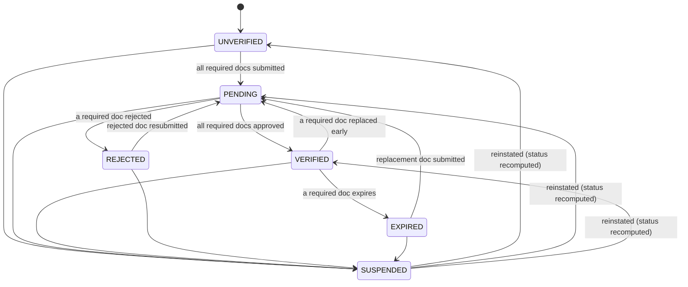
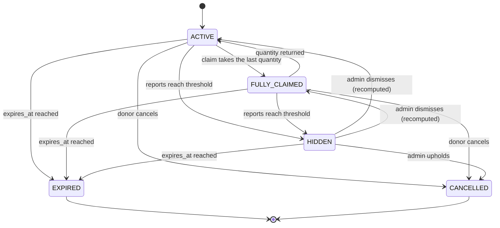
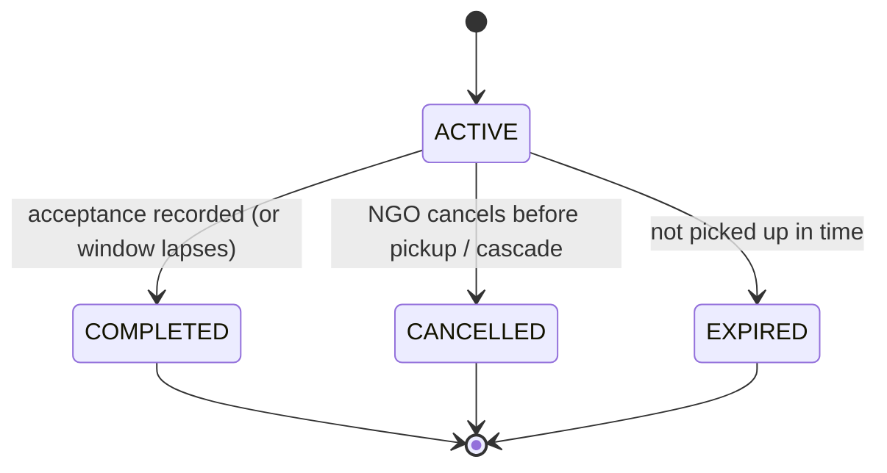
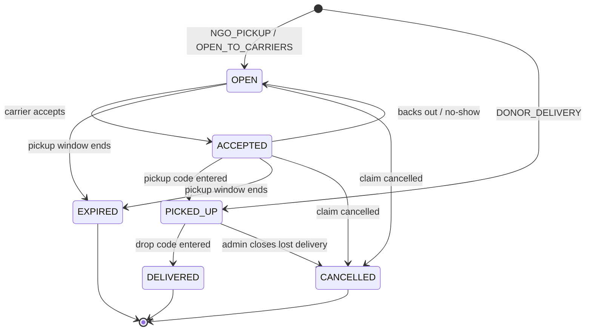
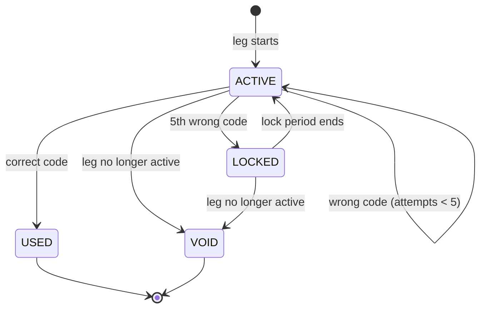

# State Machines

> **Status:** v0.1 draft, 2026-10-10. Replaces the "first idea" status lists in
> `requirements.md` §5. Field and table names follow `data-model.md`.

Each section lists every allowed move between statuses, who or what makes it,
and the conditions. **Any move not listed is refused** (NFR-CON-5).

Decisions the requirements didn't cover are marked **[J1]**, **[J2]** and so on,
and collected at the end so they can be reviewed in one place.

## How transitions are implemented

These rules apply to every machine below.

- **One conditional `UPDATE` per move.** For example:
  `UPDATE transport_tasks SET status = 'ACCEPTED', … WHERE id = $id AND status = 'OPEN'`.
  If no row is updated, the record wasn't in the expected status (someone else
  got there first, or it expired), and the API returns `409 Conflict` with the
  current status. Nothing is half-applied.
- **The custody event is written in the same transaction** (NFR-DUR-1).
- **Moves that affect several records happen in one transaction** (see
  [Cascades](#cascades)), always locking in the same order to avoid deadlocks:
  **listing → claim → transport task → handoff code**.
- **System moves** (expiry, timeouts) are run by the background worker using the
  same functions as user moves. The worker is just another caller.
- **Tests:** every row in every table gets a "this works" test. Every
  (status, action) pair not in a table gets a "this is refused" test.

---

## 1. Organisation

| From | To | Triggered by | Only if |
|---|---|---|---|
| (new) | `UNVERIFIED` | any user creates an org (FR-ORG-1) | - |
| `UNVERIFIED` | `PENDING` | System, when a document passes its automated checks | every required document type now has a document in `IN_REVIEW` or `APPROVED` |
| `PENDING` | `VERIFIED` | System, when an admin approves a document | every required document type has an `APPROVED`, unexpired document |
| `PENDING` | `REJECTED` | System, when an admin rejects a required document **[J1]** | - |
| `REJECTED` | `PENDING` | System, when the org admin resubmits | no required document type is left with only a rejected document |
| `VERIFIED` | `EXPIRED` | System, daily expiry check (FR-VER-8) | an approved required document's `expires_on` has passed |
| `EXPIRED` | `PENDING` | System, when a replacement passes its automated checks | the same rule as `UNVERIFIED → PENDING` |
| `VERIFIED` | `PENDING` | System, when the org admin replaces a document before it expires **[J2]** | - |
| any except `SUSPENDED` | `SUSPENDED` | Admin, with a reason (FR-ADM-2) | - |
| `SUSPENDED` | recomputed | Admin reinstates | the new status is worked out from the documents, as if the org were new **[J3]** |

**What each status allows:**

| Status | NGO can claim | Donor org posts at |
|---|---|---|
| `UNVERIFIED`, `PENDING`, `REJECTED` | no | Tier 0 limits |
| `VERIFIED` | yes | Tier 2 limits |
| `EXPIRED` | no | Tier 0 limits (FR-VER-8) |
| `SUSPENDED` | no | can't post |

**Effects:** see [Cascades](#cascades) for an NGO or donor org leaving
`VERIFIED`.

---

## 2. Listing

| From | To | Triggered by | Only if |
|---|---|---|---|
| (new) | `ACTIVE` | donor posts (FR-LST-1) | passes validation, tier limits (FR-LST-4) and the safe-window rule (FR-LST-2) |
| `ACTIVE` | `FULLY_CLAIMED` | System, in the claim's transaction | `quantity_claimed = quantity_total` afterwards |
| `ACTIVE` | `FULLY_CLAIMED` | donor reduces the unclaimed quantity (FR-LST-5) | `quantity_claimed = quantity_total` afterwards |
| `FULLY_CLAIMED` | `ACTIVE` | System, when a claim is cancelled or expires before pickup | `now() < expires_at` |
| `ACTIVE`, `FULLY_CLAIMED`, `HIDDEN` | `EXPIRED` | System, at `expires_at` (FR-LST-6) | - |
| `ACTIVE`, `FULLY_CLAIMED` | `CANCELLED` | donor, with a reason (FR-LST-5) | - |
| `ACTIVE`, `FULLY_CLAIMED` | `HIDDEN` | System, when reports reach `{REPORTS_TO_HIDE}` (FR-REP-4) | - |
| `HIDDEN` | `ACTIVE` or `FULLY_CLAIMED` | Admin dismisses the reports | recomputed from the quantities |
| `HIDDEN` | `CANCELLED` | Admin upholds the reports | - |

**Editing while `ACTIVE`** (not a status change):
- with no claims: any field can be edited;
- with claims: only `quantity_total` can be lowered, and never below
  `quantity_claimed` (FR-LST-5).

**Terminal:** `EXPIRED`, `CANCELLED`. A terminal listing only stops *new*
claims. Food that has already been picked up is still delivered.

---

## 3. Claim

The claim stays `ACTIVE` while the food is moving. The progress of the trip is
tracked on its transport task, not on the claim.

| From | To | Triggered by | Only if |
|---|---|---|---|
| (new) | `ACTIVE` | an NGO member claims (FR-CLM-4) | NGO is `VERIFIED`; listing is `ACTIVE`; the quantity fits (conditional `UPDATE` on the listing, NFR-CON-1); `DONOR_DELIVERY` only if the donor offered it |
| `ACTIVE` | `COMPLETED` | an NGO member records the acceptance result (FR-HND-6) | the task is `DELIVERED` |
| `ACTIVE` | `COMPLETED` | System, when `acceptance_due_at` passes with nothing recorded | the task is `DELIVERED`; result is set to `AUTO_ACCEPTED` **[J4]** |
| `ACTIVE` | `CANCELLED` | an NGO member, with a reason (FR-CLM-6) | the task is `OPEN` or `ACCEPTED`. **After pickup the NGO can't cancel**; it records a rejection on arrival instead **[J5]** |
| `ACTIVE` | `CANCELLED` | System, as a cascade (listing cancelled, org suspended or expired) | the task is `OPEN` or `ACCEPTED` |
| `ACTIVE` | `CANCELLED` | Admin closes a lost delivery | the task is `PICKED_UP` **[J6]** |
| `ACTIVE` | `EXPIRED` | System, at the listing's `expires_at` (FR-CLM-7) | the task is `OPEN` or `ACCEPTED` **[J7]** |

**Quantity rule [J8]:** a claim gives its quantity back to the listing
(`quantity_claimed -= quantity`) **only when it ends before pickup**. Food
that's been picked up has physically left the donor, so it can never be offered
again, even if the delivery fails.

---

## 4. Transport task

| From | To | Triggered by | Only if |
|---|---|---|---|
| (new) | `OPEN` | System, in the claim's transaction | mode is `NGO_PICKUP` or `OPEN_TO_CARRIERS` |
| (new) | `PICKED_UP` | System, in the claim's transaction | mode is `DONOR_DELIVERY`; the donor is the carrier (FR-TRN-1) |
| `OPEN` | `ACCEPTED` | a user accepts (FR-TRN-3/4) | `NGO_PICKUP`: they're a member of the claiming NGO. `OPEN_TO_CARRIERS`: phone verified, not suspended, meets the NGO's carrier policy, under `{CARRIER_MAX_ACTIVE_TASKS}`, didn't donate this listing. Both: carrier declaration accepted (FR-TRN-7) |
| `ACCEPTED` | `OPEN` | the carrier backs out, with a reason (FR-TRN-8) | `now() < expires_at` of the listing; otherwise → `EXPIRED` |
| `ACCEPTED` | `OPEN` | System, at `pickup_deadline_at`: a no-show (FR-TRN-9) | same as above. The carrier's assignment ends as `NO_SHOW` |
| `ACCEPTED` | `PICKED_UP` | donor-side staff enter the carrier's pickup code (FR-HND-1) | the code is valid (see §5) |
| `PICKED_UP` | `DELIVERED` | the carrier enters the NGO's drop code (FR-HND-2). In `NGO_PICKUP`, an NGO member confirms "received at facility" instead (FR-HND-4) | the code is valid, or the confirmer is an NGO member |
| `OPEN`, `ACCEPTED` | `EXPIRED` | System, at the listing's `expires_at` | - |
| `OPEN`, `ACCEPTED` | `CANCELLED` | System, when its claim is cancelled | - |
| `PICKED_UP` | `CANCELLED` | the donor withdraws a self-delivery | mode is `DONOR_DELIVERY`. The food never left the donor, so the quantity **is** returned **[J9]** |
| `PICKED_UP` | `CANCELLED` | Admin, with a reason, e.g. lost in transit **[J6]** | any other mode |

**Flags, not statuses:**
- `safe_until_breached` is set by the System if the task is still `PICKED_UP` at
  the listing's `safe_until` (FR-HND-11). The NGO is told to inspect carefully.
- A handoff more than `{ARRIVAL_CHECK_M}` from the expected point is flagged on
  the Handoff row (FR-HND-7). It doesn't block the move.

**Every time a task goes back to `OPEN`**, its unused handoff codes are voided
and new ones are issued to the next carrier **[J10]**.

---

## 5. Handoff code

One code per task and leg. It's shown by the person **receiving** the food and
entered by the person **handing it over** (FR-HND-3).

The status isn't stored as one column. It's worked out from the fields in
`data-model.md`:

| Status | Stored as |
|---|---|
| `ACTIVE` | `used_at`, `voided_at` null; `locked_until` null or in the past |
| `LOCKED` | `locked_until > now()` |
| `USED` | `used_at` set |
| `VOID` | `voided_at` set |

| From | To | Triggered by | Only if |
|---|---|---|---|
| (new) | `ACTIVE` | System. **Pickup code:** when the task becomes `ACCEPTED`, shown on the carrier's phone. **Drop code:** when the task becomes `PICKED_UP`, shown on the NGO's phone | no other unused, unvoided code exists for this task and leg |
| `ACTIVE` | `ACTIVE` | the giver enters a wrong code | `attempts + 1 < 5` |
| `ACTIVE` | `LOCKED` | the giver enters the 5th wrong code (NFR-SEC-3) | locked for `{OTP_LOCK_MIN}`; both people notified |
| `LOCKED` | `ACTIVE` | time: `locked_until` passes | `attempts` resets to 0 |
| `ACTIVE` | `USED` | the giver enters the correct code | `UPDATE … WHERE used_at IS NULL AND voided_at IS NULL`, so only one request can ever succeed (NFR-CON-4). The task moves in the same transaction |
| `ACTIVE`, `LOCKED` | `VOID` | System, when the task leaves the step this code belongs to (back to `OPEN`, cancelled or expired) | - |

Codes are compared in constant time against `code_hash`, and only while `ACTIVE`.
A wrong code on a `LOCKED` code doesn't count as an attempt and gets the same
"locked" response whether or not it's correct.

**Out of scope here:** offline handoff (FR-HND-10, [S]). Checking a code while
one phone is offline needs a different scheme, such as a code both phones can
derive. That gets its own design when the feature is built.

---

## Cascades

Moves that change more than one record. Each row is **one transaction**.

| Event | Effects |
|---|---|
| Claim created | listing `quantity_claimed += q` (and maybe `→ FULLY_CLAIMED`); task created (`OPEN`, or `PICKED_UP` for donor delivery); for donor delivery, the drop code is issued |
| Claim cancelled or expired before pickup | listing `quantity_claimed -= q` (and maybe `FULLY_CLAIMED → ACTIVE`); task `→ CANCELLED` or `EXPIRED`; codes `→ VOID`; carrier's assignment ends as `CANCELLED` |
| Listing cancelled by the donor | every claim not yet picked up `→ CANCELLED`, with the cascade above; those NGOs notified; counts against the donor's reliability (FR-LST-5) |
| Listing expires | every claim not yet picked up `→ EXPIRED` **[J7]** |
| Listing hidden by reports | no new claims; existing claims continue, and their NGOs are notified **[J11]** |
| NGO `VERIFIED → EXPIRED` or `SUSPENDED` | its claims not yet picked up `→ CANCELLED`; food already picked up is still delivered (requirements §10 Q2) |
| Donor org `→ SUSPENDED` | its `ACTIVE` and `FULLY_CLAIMED` listings `→ CANCELLED`, with the cascade above **[J12]** |
| Donor org `VERIFIED → EXPIRED` | nothing changes for existing listings; new ones use Tier 0 limits (FR-VER-8) |
| User suspended | as a carrier: `ACCEPTED` tasks go back to `OPEN`; `PICKED_UP` tasks continue to delivery and are flagged for an admin **[J13]**. As a donor: their personal listings are cancelled |
| Task `ACCEPTED → PICKED_UP` | pickup code `→ USED`; drop code issued |
| Task `PICKED_UP → DELIVERED` | drop code `→ USED`; claim's `acceptance_due_at` set |
| Task `PICKED_UP → CANCELLED` (lost delivery) | claim `→ CANCELLED`; quantity **not** returned; carrier's assignment ends as `CANCELLED`; flagged for an admin |

---

## Decisions to review

The requirements were silent on these, so the draft picks an answer. Each
can be changed without affecting the rest of the design.

| # | Decision | Reason |
|---|---|---|
| J1 | Rejecting **one** required document moves the org to `REJECTED` until it's resubmitted | the org admin sees one clear status instead of "pending, but one doc is dead" |
| J2 | Replacing a document early moves a `VERIFIED` org back to `PENDING` | otherwise an unreviewed document would count towards verification |
| J3 | Reinstating a suspended org recomputes its status from its documents | storing "the status before suspension" goes stale if documents expire during the suspension |
| J4 | If the NGO doesn't record acceptance in time, the claim completes as `AUTO_ACCEPTED` | the food was delivered and nobody objected. It counts as accepted for the donor, and against the NGO's reliability, and is shown separately |
| J5 | After pickup, the NGO can't cancel. It receives the food and can reject it | food in someone's hands needs somewhere to go; cancelling would leave the carrier stranded |
| J6 | Food lost after pickup can only be closed by an admin | it's rare, it's serious, and it needs a human to look at the carrier and the custody log |
| J7 | When a listing expires, claims not yet picked up expire too | `expires_at` is the earlier of safe-until and the pickup window; collecting food after it's unsafe is the thing the platform exists to prevent |
| J8 | Quantity goes back to the listing only if the claim ended before pickup | food that's left the donor can't be offered again |
| J9 | A donor can withdraw a self-delivery, and the quantity is returned | the food never left them |
| J10 | A task that goes back to `OPEN` gets new codes | the previous carrier's pickup code must not work for the next carrier |
| J11 | A hidden listing's existing claims continue | reports aren't proof; cancelling on reports alone would let anyone sabotage a donation |
| J12 | Suspending a donor org cancels its open listings | a suspended org shouldn't keep handing out food under the platform's name |
| J13 | A suspended carrier holding food still delivers it | the food is better off at the NGO than stuck with the carrier; an admin follows up |
